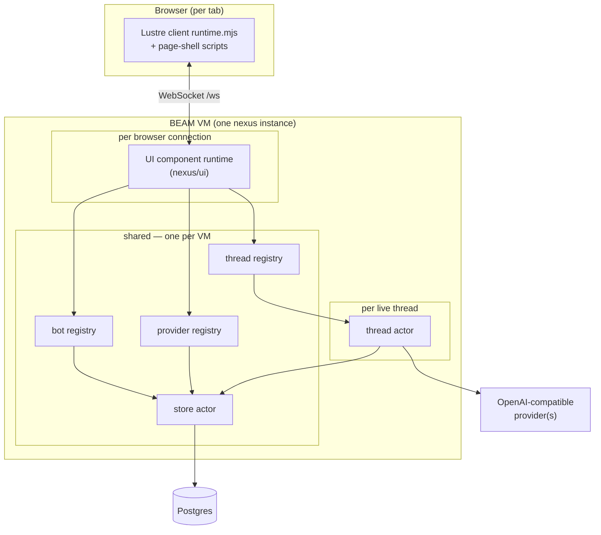
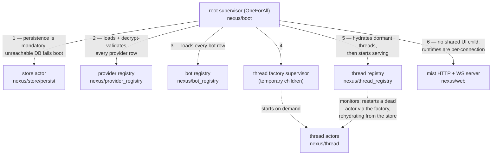
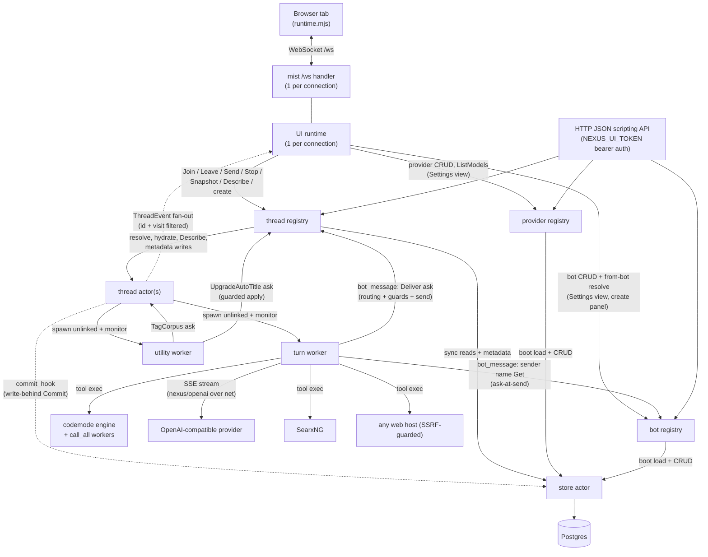
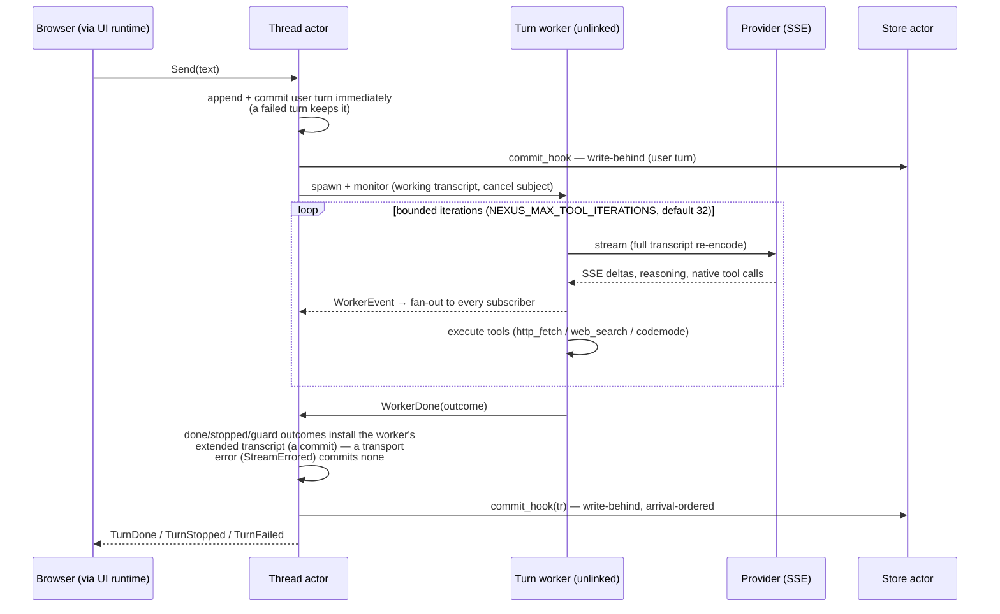

# Architecture — actors, lifetimes, and communication

Nexus is a Gleam-on-BEAM multi-thread chat server: every live thread is an actor
(dormant persisted threads are store rows until first use),
browser tabs each get their own UI runtime, and all model I/O happens in
short-lived worker processes so a crash can never take more than its own turn
down. This document maps **which processes exist, what each one is scoped to
(VM / browser connection / thread / turn), and who talks to whom**.

For module-by-module responsibilities see the README's Architecture section;
for the hard invariants (KV-cache contract, UI rules, schema rules) see
`AGENTS.md`. This file tracks the code at `HEAD` — if it disagrees with
`src/nexus`, the code wins; fix the doc.

Diagrams are [Mermaid](https://mermaid.js.org/) — rendered natively by
GitHub/GitLab and kept as reviewable text.

---

## 1. The big picture

Three long-lived layers, plus per-thread and per-turn ephemera:

The rest of this document names every process, its lifetime, and its edges.

---

## 2. The supervision tree

`nexus/boot` builds one `OneForAll` root. Start order matters and is
commented in the code: the registries hydrate from the store, threads
resolve providers through the provider registry, and HTTP traffic must find
a live registry.

Crash policy: the tree is deliberately aggressive. A crash loop at the root
halts the VM and the *outer* supervisor (Nomad job / run script) restarts it
into a clean state; **persisted** history is rehydrated from the store —
with the caveat that turn commits travel the write-behind lane, so anything
still queued at the moment of a crash is lost (the PRD accepts this window
for the MVP). Everything below is
designed so that the only things that can kill a supervised actor are its
own bugs — network and tool failures are contained in unlinked workers
(§5).

---

## 3. Process inventory by scope

This is the table the rest of the doc expands on: **what is shared, and
what is tied to what**.

| Process | Actor? | Count | Lifetime | Scope / tied to |
|---|---|---|---|---|
| store actor (`nexus/store/persist`) | y | 1 per VM | boot → shutdown | shared by everything; owns the Postgres pool |
| provider registry (`nexus/provider_registry`) | y | 1 per VM | boot → shutdown | shared; owns provider rows + plaintext keys |
| bot registry (`nexus/bot_registry`) | y | 1 per VM | boot → shutdown | shared; owns bot rows (no secrets — the stored row is the public shape) |
| thread registry (`nexus/thread_registry`) | y | 1 per VM | boot → shutdown | shared; owns thread IDs → live subjects |
| mist server (`nexus/web`) | y (listener) | 1 listener per VM | boot → shutdown | shared; spawns one bare handler process per HTTP request / WS connection |
| UI component runtime (`nexus/ui_runtime` → `nexus/ui`) | y | 1 per WebSocket | **linked to the socket handler** — the pair dies together | browser connection |
| thread actor (`nexus/thread`) | y | 0..N | created on demand; replaced by the registry on crash | one thread (server-global, not per client) |
| turn worker (runs `nexus/loop`) | n | ≤ 1 per thread at a time | one turn | one turn; unlinked + monitored by its thread actor |
| codemode engine child (`nexus/codemode`) | n | 0..1 per turn worker | one codemode tool call | one tool call; **linked to the turn worker** |
| `tools.call_all` batch workers | n | one per batch entry | ≤ script deadline | one tool call; **linked to the codemode engine** |
| utility worker (runs `nexus/utility`) | n | ≤ 1 per thread | one title/tags attempt | one thread, background; unlinked + monitored |
| provider `ListModels` fetch | n | 1 per request | one HTTP call | one-off inside the provider registry; unlinked |

**What "Actor?" means:** a `gleam_otp` actor — a mailbox-driven state
machine with its own message type, addressed through `Subject`s. This
includes the UI component runtime: it is an OTP actor started per socket
(`lustre.start_server_component` over `actor.start`), just called a
"runtime" because its messages are Lustre's. The `n` rows are **bare BEAM
processes running one function to completion**: nobody sends them
messages — their owner only holds a cancel subject *for* them (turn,
utility) or monitors their exit, and the link/monitor edges are what
contain their failures (§5).

Notes on the "ties":

- **No actor is tied to an LLM *connection*, because there are none.** Every
  model call is a fresh HTTP + SSE exchange. What is frozen per *thread*
  is the resolved `openai.Endpoint` (provider base URL + key + timeouts,
  pinned at create/hydration) and the tool schema set (the
  creation-time `thread.toolset` snapshot, resolved per toolset into
  cached runner bundles — bots plan P2; the default snapshot shares the
  boot-built bundle). Both freezes serve the KV-cache contract.
- **Browser connection** ties: exactly one UI runtime per `/ws` socket.
  Nothing UI-side is shared between connections; threads themselves are
  server-global, so every tab sees the same sidebar.
- **Postgres** is mandatory: there is no ephemeral fallback — if the store
  actor cannot start, boot fails.

---

## 4. Communication map

Among the nexus-process edges: solid = synchronous request/response
(`actor.call` / subject ask); dashed = fire-and-forget message sends.
External transports are labeled on their own edges — the browser edge is a
WebSocket, `store → Postgres` is the pool connection — and are neither.

### Message vocabulary (what actually flows)

- **UI runtime → thread registry**: `Join` (subscribe + replay), `Leave`,
  `Send`/`Stop` (turn control), create/patch/delete, archive, tag ops, and
  `Describe` for sidebar summaries. Threads are resolved by ID at request
  time, so messages reach the live actor after a registry-owned restart.
- **Thread actor → subscribers**: `ThreadEvent(thread_id, visit, kind)`
  fan-out — `Hello`, `UserEcho`, `Token`, `Reasoning`, `AssistantFull`,
  `TurnDone/TurnStopped/TurnFailed`, tool-call lifecycle, `MetaUpdated`
  (title/tags changed → every connected tab refreshes its sidebar).
  The `thread_id` + `visit` generation pair are **filter keys**, not
  bookkeeping: a subscriber shares ONE event subject across every thread it
  visits, and these two fields are what let the UI drop deliveries from the
  wrong thread or a stale earlier visit.
- **Registry → thread** is the primary direction — a thread actor's own
  message loop never calls back into the registry. The thread sees the
  outside world through closures injected at start: the turn runner, the
  `commit_hook` (store write-behind lane), and its frozen endpoint. The
  exceptions all live in UNLINKED WORKERS, never a thread actor (§8 rule
  1's exception class): the utility worker asks its thread actor for the
  tag corpus (`TagCorpus`) and asks the registry to land the parsed
  title/tags (`UpgradeAutoTitle`); the turn worker's `bot_message` tool
  asks the bot registry for the sender's current display name (ask-at-send
  — the `From` prefix stays current across renames; a deleted sender is an
  honest tool error) and asks the thread registry to route + deliver
  (`Deliver` — guards, DM find-or-create, the send into the target).
  All are deadlock-safe because they originate in workers nothing waits
  on synchronously and their answer paths never call into a waiting
  worker (§8 rule 1).
- **Scripting API → registries**: the same registry subjects the UI uses,
  over bearer-token-authenticated JSON routes (`/threads` CRUD + send/stop,
  `/providers` CRUD + model listing, `/bots` CRUD and the `{"bot": id}`
  half of `POST /threads`; `/healthz` is the one open route).
- **No registry-to-registry edges.** The bot registry, provider registry,
  and thread registry are mutually ignorant; orchestration lives with the
  callers (web and the UI runtime, through `nexus/thread_create` — the
  one creation path both surfaces share):
  - `POST`/`PATCH /bots` validate `provider_id` against the
    provider-registry subject the web layer already holds (friendly
    400; the `ON DELETE RESTRICT` FK is the backstop);
  - the provider registry's delete guard counts bots through the
    STORE (`count_bots_for_provider`, riding both halves of the guard
    alongside `count_threads_for_provider`) — never a call into the
    bot registry;
  - create-from-bot resolves the bot in `thread_create`, copies its
    frozen values into the creation request, and re-validates the
    model alias against the provider's LIVE list (a stale bot must
    400, never silently succeed); the thread registry never sees
    bots beyond the `bot_id` provenance column.
  - bots P3c: the thread registry holds the bot registry's NAME (boot
    wiring, like the provider resolver seam) only to build the
    `bot_message` tool's sender-name closure, which resolves it at ask
    time INSIDE the turn worker — no message ever flows
    registry→registry. The delivery path's bot lookups (target by name,
    `allow_inbound` gate) are STORE reads, the same
    count/guard-through-the-store pattern as the provider delete guard.

---

## 5. Ephemeral workers (crash containment)

Network-facing work runs **outside the actor that owns it**, spawned
unlinked so a crash or timeout kills at most the task that was running.
The turn and utility workers are additionally **monitored**; two deliberate
exceptions to the "monitored" half: the provider registry's `ListModels`
fetch is unlinked and **unmonitored** (a one-off HTTP call whose reply is
simply dropped if the caller's budget already expired), and the store's
Postgres queries run **inside** the supervised store actor:

- **Turn worker** — runs the bounded agent loop (`nexus/loop`): stream →
  assemble tool calls → execute → append → stream again, until done, guard,
  user `Stop`, or transport failure. It holds its *own* working transcript;
  the thread actor's committed transcript advances at TWO points: at
  `Send` (the user message is appended and committed immediately, hook
  fired before the worker starts) and at `WorkerDone` (done/stopped/guard
  outcomes install the worker's extended transcript and fire the hook —
  note the iteration guard is one of the committing outcomes; only a
  transport error, `StreamErrored`, commits nothing).
  The cancel subject is threaded through every stream call and tool run, so
  `Stop` kills an in-flight script and answers not-yet-started sibling
  calls with synthetic cancelled results.
  Bots P3c: when the thread is a bot's, the loop's `ToolCtx` carries the
  delivery identity (the registry wrapper's per-thread context), so a
  `bot_message` tool call performs the two registry asks from this worker
  (§4/§8 rule 1) — delivery is async (a receipt), and an ask timeout is a
  retryable tool error, never a crash.
- **Codemode engine** — for a codemode tool call, the turn worker spawns a
  **linked** engine child running the sandboxed Lua VM (wall-clock
  deadline kill, ~64 MiB heap ceiling). The engine in turn spawns
  **linked** `tools.call_all` workers for parallel sibling-tool batches.
  The links are deliberate: teardown should cascade inward, while the
  worker itself stays unlinked from the actor above it.
- **Utility worker** — background title/tags branch (`nexus/utility`),
  spawned once per eligible thread after a committed exchange (debounced,
  once-per-thread, `PASS` re-arms). It piggybacks on the committed
  transcript's cached prefix with the thread's frozen envelope plus a
  `max_completion_tokens` delta. It is invisible to callers: a `Send`
  arriving mid-attempt **cancels** it instead of reporting `Busy`, and its
  reply becomes thread metadata (title/tags), never transcript content.
  It lands its own result: the worker asks its thread actor for the tag
  corpus (`TagCorpus`) and asks the registry to apply the parsed title and
  tags behind the `UpgradeAutoTitle` provenance guard (the injected
  `utility_apply_for` closure) — the only calls that flow from the thread
  side into the registry (§8 rule 1).
- **`ListModels` fetch** — the provider registry resolves an endpoint from
  state synchronously, then runs the live HTTP fetch in an unlinked,
  unmonitored process (if the caller's call budget expired, the reply is
  dropped — nobody waits on the fetch), so a slow provider can never stall
  `Resolve` (which sits on the
  thread-create path).

---

## 6. Shared actors in detail

### Store actor (`nexus/store/persist`)

One pog-backed actor owning the single Postgres pool. Two lanes:

- **Write-behind**: turn commits arrive as fire-and-forget `Commit`
  messages from thread actors' injected commit hooks and are applied
  strictly in arrival order; every message insert is
  `on conflict (thread_id, seq) do nothing`, so crash-recovery replays
  are idempotent.
- **Write-through (synchronous)**: reads and metadata mutations, called by
  the thread registry and both settings registries (provider, bot).

The `nexus/store` module above it is the mockable seam (record of
functions) plus pure transcript⇄row mappers — `gleam test` never touches a
database.

### Provider registry

Loads and decrypt-validates the whole provider table at boot (bad envelope
or unreachable store fails boot loudly). Plaintext keys exist only inside
`ResolvedProvider` handed to callers; reads reply with masked metadata.
Resolve decrypts lazily into a memo invalidated by update/delete. CRUD
pre-checks existence/name-uniqueness in state; deletes are refused while
threads OR BOTS pin the provider (`ON DELETE RESTRICT` — both halves of
the guard are store counts; see the no-cross-edges rule in §4).

### Bot registry

Owns the `bot` rows (named creation-time thread templates: default
provider + model + system prompt, no secrets — the stored row IS the
public shape). Loads the whole table at boot (an unreachable store fails
boot); write-through CRUD with the in-state duplicate-name pre-check;
deletes are unguarded because `thread.bot_id` is `ON DELETE SET NULL`
provenance — a bot's threads keep their frozen columns. A stale model
alias is legitimate at rest: thread create re-validates it against the
provider's live list. Never resolves providers (§4's no-edges rule) and
never touches the network.

### Thread registry

Owns user-visible thread IDs, aliases, and the subjects of live actors.
Hydrates the dormant set from the store at boot (after pruning never-used
threads), lazily starts hydrated actors on first `Get`, and owns the
monitors that replace a dead thread actor through the factory — the
replacement rehydrates from the store, so the rebuilt transcript re-encodes
byte-identically (§2's write-behind loss window applies here too: the last
commits still queued at the crash are missing from the rehydrated set).

Bots P3c adds three things (issue #97):

- **The bot-default toolset transform**: a create from a bot with the
  default sentinel (`toolset: NULL`) snapshots the human default set PLUS
  `bot_message` — the delivery tool every ordinary bot carries without
  listing it. The human default set never includes it; an explicit bot
  toolset wins verbatim. Everything resolves through the same bundle
  cache as any other snapshot.
- **The per-thread delivery wrapper**: on bot threads (`bot_id` set) the
  registry wraps the cached bundle's turn fn at create/hydrate, closing
  over the thread id + bot id and the two worker-side ask closures. The
  wrapper computes the turn's hop depth from the initiating user
  message's sidecar depth + 1 (a human send resets to 0) — persisted
  data, so the counter survives restarts. The bundle cache keeps the
  unwrapped runner (identity is per-THREAD, never per-toolset).
- **`Deliver` + the DM map**: the routing ask behind `bot_message`.
  Guards, in order: unknown target; self-addressing (any resolved target
  whose bot is the sender's own — refused BEFORE routing, because a
  name-addressed self-send would otherwise find-or-create a second,
  idle A-thread); archived target; the `allow_inbound` gate (a STORE
  read, never a bot-registry call); hop depth (`NEXUS_MAX_BOT_HOPS`);
  busy target (`Busy` — the target actor answers immediately in both
  states). Name addressing routes through an in-memory per (sender bot,
  target bot) DM-thread map, find-or-creating from the target bot
  through the same internal start path as any create (no second
  frozen-value path; the live model-alias revalidation `thread_create`
  performs for user-facing creates is deliberately skipped here — it is
  a network call, and no network call may run inside this actor). A
  restart loses the map and opens a fresh DM thread on the next
  name-addressed delivery — receipts and `From` prefixes carry thread
  ids precisely so models can bypass the map by addressing the id.

### Thread actor

Owns, per thread: the committed transcript (in-memory authority),
the fan-out subscriber map (each entry monitored — a dying connection is
pruned automatically), the turn lifecycle (one turn at a time; `Send` while
streaming is rejected `Busy`), the display-only `turn_view` mirror (lets
mid-turn joins replay the in-flight turn), bounded metric history, and
utility-attempt bookkeeping.

---

## 7. LLM endpoints vs. browser connections — what is frozen where

| Frozen thing | Scope | Why |
|---|---|---|
| Tool schemas + `tool_choice` envelope | per thread (the creation-time `thread.toolset` snapshot, resolved into bundles cached per toolset; the default snapshot shares the boot-built bundle) | the envelope never varies mid-thread, so prefixes stay cacheable; threads of one toolset still share their tools head |
| `openai.Endpoint` (base URL, key, timeouts) + model | per thread, pinned at create/hydration | a thread only ever exists with its (provider, model) pin in place |
| System prompt | per thread (refrozen from `thread.system_prompt` on hydration) | part of the immutable prefix |
| Request bytes | per prefix — immutable forever (`nexus/transcript.to_request` is the only encode path) | the KV-cache contract |
| UI runtime + per-client model | per browser connection | tabs never mirror each other; a UI crash costs one socket |

---

## 8. Dependency rules (structural, do not add edges)

1. **registry → thread is the primary direction; unlinked workers may ask
   the registries — the exception CLASS.** A thread actor's own message
   loop never calls the registry. The thread sees the outside world
   through closures injected at start. The asks that DO cross registry
   boundaries all originate in UNLINKED WORKERS (never a thread actor):
   the utility worker's `TagCorpus` + guarded `UpgradeAutoTitle` asks
   (utility-titles plan), and — from bots P3c — the turn worker's
   delivery asks: `bot_message`'s sender display-name `Get` against the
   bot registry and the `Deliver` routing ask against the thread
   registry (both built as closures by the registry's per-thread runner
   wrapper; the bot registry is resolved BY NAME at ask time, so no
   registry-to-registry edge exists). Deadlock-safe by construction: the
   ask originates in a worker nothing waits on synchronously (the actor
   monitors, never blocks on, its workers); each answer path is bounded —
   registry state, a few synchronous store reads (`list_bots`/`get_bot`),
   and at most one bounded ask into an idle-or-immediately-answering
   actor (the target thread replies `Sent`/`Busy` without waiting on its
   own worker; the bot registry answers from boot-loaded state) — and no
   path leads from a registry back into a waiting worker, so no cycle
   can close. Every ask on the path is a manual send plus bounded
   receive on an asker-owned subject (`actor.call` would panic the
   asker on a dead/stalled callee), so a timeout degrades to a refusal
   or a retryable tool error, never a crash. Deliveries serialize
   through the registry actor: under heavy cross-traffic a worker's
   bounded ask times out as that unknown-outcome tool error, never a
   deadlock.
2. **thread → store only via the injected `commit_hook`** (fire-and-forget);
   all other store access goes through the registries.
3. **threads never call the provider registry.** Boot injects a resolver
   into the thread registry; endpoints are frozen into the thread spec
   before the actor exists. The bot registry follows the same shape: no
   registry-to-registry edges at all — caller-side validation and
   cross-entity guards go through the store or the orchestrating caller
   (`thread_create`), never actor-to-actor calls.
4. **`nexus/codemode` is a leaf** — it must not import `nexus/tools`, or the
   codemode tool could invoke itself.
5. **`nexus/transcript` is the single request-encoding path.** No volatile
   metadata (thread IDs, metrics, timestamps, reasoning) may enter it;
   sidecars live on the transcript, never in `messages`.
6. **One UI runtime per socket, no shared UI state.** Static assets are
   vendored and served by nexus itself — no public CDNs.

---

## 9. External systems

| System | Used by | Notes |
|---|---|---|
| Postgres | store actor | mandatory; idempotent schema applied by `nexus/store/migrate` |
| OpenAI-compatible provider(s) | turn + utility workers, provider registry (`ListModels`) | N rows in the provider table; streaming SSE with cancel + timeouts (`nexus/openai`) |
| SearxNG | `web_search` tool (turn worker) | optional; tool absent from the schema when unconfigured |
| Any web host | `http_fetch` tool (turn worker) | SSRF-guarded, size- and time-bounded |
| Browser | UI runtime via `/ws`; scripting API via JSON | client scripts served self-hosted from `priv/` |

## 10. Out-of-VM entry points

Separate OS processes from the same codebase — none of them are actors:

- `nexus/boot` (`main`) — the server described above.
- `nexus/store/migrate` — applies `sql/schema.sql` idempotently; the only
  schema-apply path.
- `nexus/dev_seed` — out-of-band first-provider seeding (CI / compose
  bootstrap, before the server exists).
- `audit/ttft` — standalone warm/cold TTFT audit harness, deliberately
  decoupled from the server's config module.
- `gleam test` — fully offline; persistence goes through the in-memory
  store seam, and the golden prefix test replays an archived real thread.
