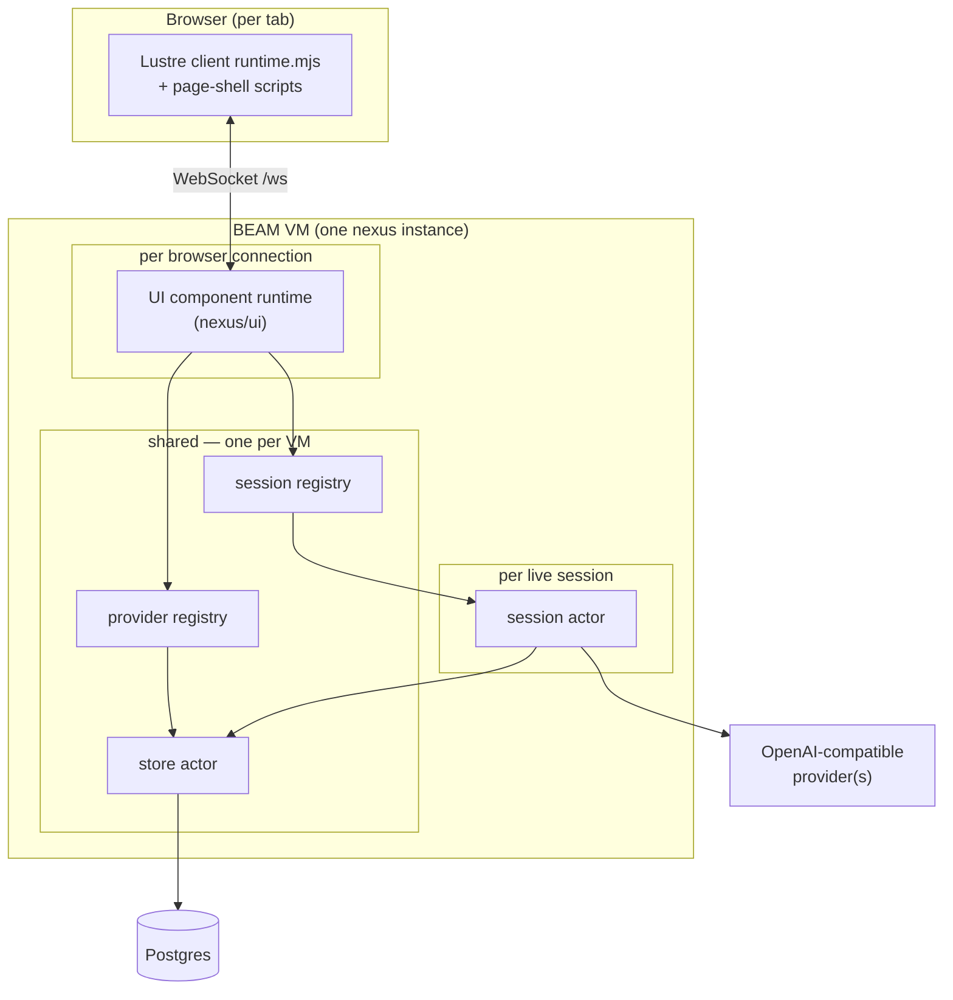
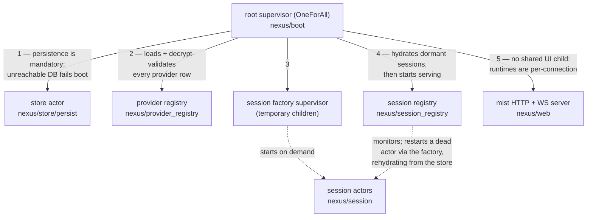
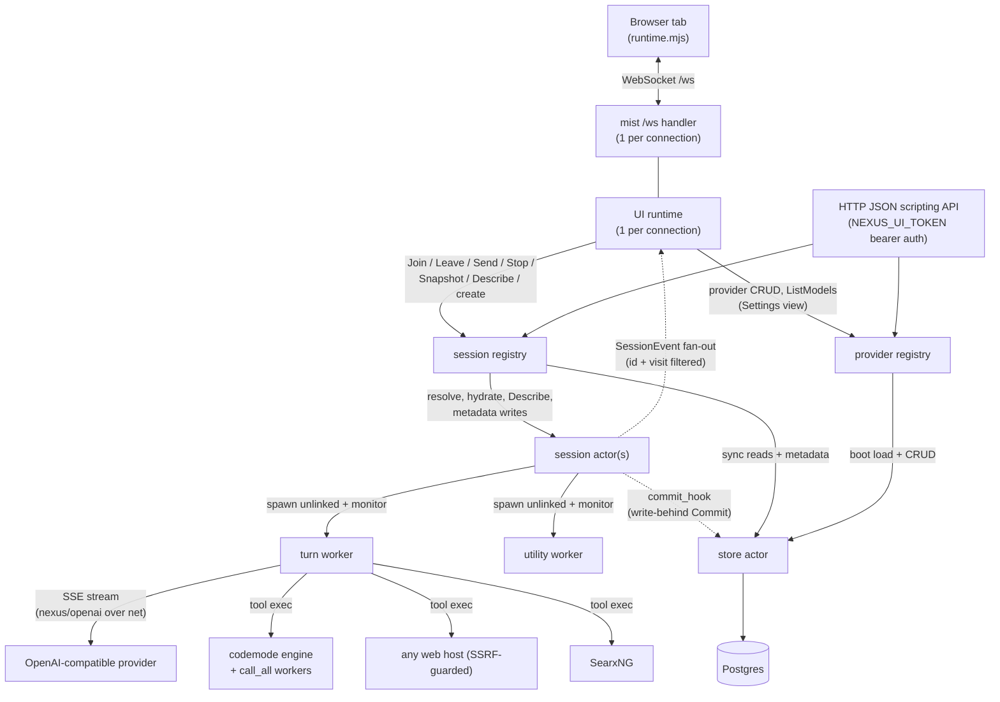
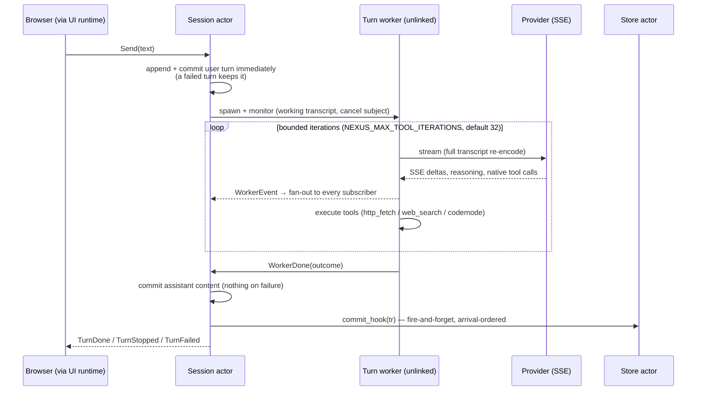

# Architecture — actors, lifetimes, and communication

Nexus is a Gleam-on-BEAM multi-session chat server: every session is an actor,
browser tabs each get their own UI runtime, and all model I/O happens in
short-lived worker processes so a crash can never take more than its own turn
down. This document maps **which processes exist, what each one is scoped to
(VM / browser connection / session / turn), and who talks to whom**.

For module-by-module responsibilities see the README's Architecture section;
for the hard invariants (KV-cache contract, UI rules, schema rules) see
`AGENTS.md`. This file tracks the code at `HEAD` — if it disagrees with
`src/nexus`, the code wins; fix the doc.

Diagrams are [Mermaid](https://mermaid.js.org/) — rendered natively by
GitHub/GitLab and kept as reviewable text.

---

## 1. The big picture

Three long-lived layers, plus per-session and per-turn ephemera:

The rest of this document names every process, its lifetime, and its edges.

---

## 2. The supervision tree

`nexus/boot` builds one `OneForAll` root. Start order matters and is
commented in the code: the registry hydrates from the store, sessions
resolve providers through the provider registry, and HTTP traffic must find
a live registry.

Crash policy: the tree is deliberately aggressive. A crash loop at the root
halts the VM and the *outer* supervisor (Nomad job / run script) restarts it
into a clean state; history survives via the store. Everything below is
designed so that the only things that can kill a supervised actor are its
own bugs — network and tool failures are contained in unlinked workers
(§5).

---

## 3. Process inventory by scope

This is the table the rest of the doc expands on: **what is shared, and
what is tied to what**.

| Process | Actor? | Count | Lifetime | Scope / tied to |
|---|---|---|---|---|
| store actor (`nexus/store/persist`) | y | 1 per VM | boot → shutdown | shared by everything; owns the Postgres pool |
| provider registry (`nexus/provider_registry`) | y | 1 per VM | boot → shutdown | shared; owns provider rows + plaintext keys |
| session registry (`nexus/session_registry`) | y | 1 per VM | boot → shutdown | shared; owns session IDs → live subjects |
| mist server (`nexus/web`) | y (listener) | 1 listener per VM | boot → shutdown | shared; spawns one bare handler process per HTTP request / WS connection |
| UI component runtime (`nexus/ui_runtime` → `nexus/ui`) | y | 1 per WebSocket | **linked to the socket handler** — the pair dies together | browser connection |
| session actor (`nexus/session`) | y | 0..N | created on demand; replaced by the registry on crash | one session (server-global, not per client) |
| turn worker (runs `nexus/loop`) | n | ≤ 1 per session at a time | one turn | one turn; unlinked + monitored by its session actor |
| codemode engine child (`nexus/codemode`) | n | 0..1 per turn worker | one codemode tool call | one tool call; **linked to the turn worker** |
| `tools.call_all` batch workers | n | one per batch entry | ≤ script deadline | one tool call; **linked to the codemode engine** |
| utility worker (runs `nexus/utility`) | n | ≤ 1 per session | one title/tags attempt | one session, background; unlinked + monitored |
| provider `ListModels` fetch | n | 1 per request | one HTTP call | one-off inside the provider registry; unlinked |

**What "Actor?" means:** a `gleam_otp` actor — a mailbox-driven state
machine with its own message type, addressed through `Subject`s. This
includes the UI component runtime: it is an OTP actor started per socket
(`lustre.start_server_component` over `actor.start`), just called a
"runtime" because its messages are Lustre's. The `n` rows are **bare BEAM
processes running one function to completion**: nobody sends them
messages — their owner only holds a cancel subject *for* them (turn,
utility) or monitors their exit, and the link/monitor edges are what
contain their failures (§5).

Notes on the "ties":

- **No actor is tied to an LLM *connection*, because there are none.** Every
  model call is a fresh HTTP + SSE exchange. What is frozen per *session*
  is the resolved `openai.Endpoint` (provider base URL + key + timeouts,
  pinned at create/hydration); what is frozen per *VM lifetime* is the tool
  schema set (built once at boot, `nexus/tools`). Both freezes serve the
  KV-cache contract.
- **Browser connection** ties: exactly one UI runtime per `/ws` socket.
  Nothing UI-side is shared between connections; sessions themselves are
  server-global, so every tab sees the same sidebar.
- **Postgres** is mandatory: there is no ephemeral fallback — if the store
  actor cannot start, boot fails.

---

## 4. Communication map

Solid edges are synchronous `actor.call` request/response; dashed edges are
fire-and-forget message sends.

### Message vocabulary (what actually flows)

- **UI runtime → session registry**: `Join` (subscribe + replay), `Leave`,
  `Send`/`Stop` (turn control), create/patch/delete, archive, tag ops, and
  `Describe` for sidebar summaries. Sessions are resolved by ID at request
  time, so messages reach the live actor after a registry-owned restart.
- **Session actor → subscribers**: `SessionEvent(session_id, visit, kind)`
  fan-out — `Hello`, `UserEcho`, `Token`, `Reasoning`, `AssistantFull`,
  `TurnDone/TurnStopped/TurnFailed`, tool-call lifecycle, `MetaUpdated`
  (title/tags changed → every connected tab refreshes its sidebar).
  The `session_id` + `visit` generation pair are **filter keys**, not
  bookkeeping: a subscriber shares ONE event subject across every session it
  visits, and these two fields are what let the UI drop deliveries from the
  wrong session or a stale earlier visit.
- **Registry → session** only, never the reverse. A session's code path
  never calls back into the registry (it would deadlock); the session sees
  the outside world only through closures injected at start: the turn
  runner, the `commit_hook` (store write-behind lane), and its frozen
  endpoint.
- **Scripting API → registries**: the same registry subjects the UI uses,
  over bearer-token-authenticated JSON routes (`/sessions` CRUD + send/stop,
  `/providers` CRUD + model listing; `/healthz` is the one open route).

---

## 5. Ephemeral workers (crash containment)

All network-facing work runs in **unlinked, monitored** workers spawned by
the owning actor, so a crash or timeout kills at most the turn that was
running:

- **Turn worker** — runs the bounded agent loop (`nexus/loop`): stream →
  assemble tool calls → execute → append → stream again, until done, guard,
  user `Stop`, or transport failure. It holds its *own* working transcript;
  the session actor's committed transcript only advances at `WorkerDone`.
  The cancel subject is threaded through every stream call and tool run, so
  `Stop` kills an in-flight script and answers not-yet-started sibling
  calls with synthetic cancelled results.
- **Codemode engine** — for a codemode tool call, the turn worker spawns a
  **linked** engine child running the sandboxed Lua VM (wall-clock
  deadline kill, ~64 MiB heap ceiling). The engine in turn spawns
  **linked** `tools.call_all` workers for parallel sibling-tool batches.
  The links are deliberate: teardown should cascade inward, while the
  worker itself stays unlinked from the actor above it.
- **Utility worker** — background title/tags branch (`nexus/utility`),
  spawned once per eligible session after a committed exchange (debounced,
  once-per-session, `PASS` re-arms). It piggybacks on the committed
  transcript's cached prefix with the session's frozen envelope plus a
  `max_completion_tokens` delta. It is invisible to callers: a `Send`
  arriving mid-attempt **cancels** it instead of reporting `Busy`, and its
  reply becomes session metadata (title/tags), never transcript content.
- **`ListModels` fetch** — the provider registry resolves an endpoint from
  state synchronously, then runs the live HTTP fetch in an unlinked process,
  so a slow provider can never stall `Resolve` (which sits on the
  session-create path).

---

## 6. Shared actors in detail

### Store actor (`nexus/store/persist`)

One pog-backed actor owning the single Postgres pool. Two lanes:

- **Write-behind**: turn commits arrive as fire-and-forget `Commit`
  messages from session actors' injected commit hooks and are applied
  strictly in arrival order; every message insert is
  `on conflict (session_id, seq) do nothing`, so crash-recovery replays
  are idempotent.
- **Write-through (synchronous)**: reads and metadata mutations, called by
  the session registry and provider registry.

The `nexus/store` module above it is the mockable seam (record of
functions) plus pure transcript⇄row mappers — `gleam test` never touches a
database.

### Provider registry

Loads and decrypt-validates the whole provider table at boot (bad envelope
or unreachable store fails boot loudly). Plaintext keys exist only inside
`ResolvedProvider` handed to callers; reads reply with masked metadata.
Resolve decrypts lazily into a memo invalidated by update/delete. CRUD
pre-checks existence/name-uniqueness in state; deletes are refused while
sessions pin the provider (`ON DELETE RESTRICT`).

### Session registry

Owns user-visible session IDs, aliases, and the subjects of live actors.
Hydrates the dormant set from the store at boot (after pruning never-used
sessions), lazily starts hydrated actors on first `Get`, and owns the
monitors that replace a dead session actor through the factory — the
replacement rehydrates from the store, so the rebuilt transcript re-encodes
byte-identically.

### Session actor

Owns, per session: the committed transcript (in-memory authority),
the fan-out subscriber map (each entry monitored — a dying connection is
pruned automatically), the turn lifecycle (one turn at a time; `Send` while
streaming is rejected `Busy`), the display-only `turn_view` mirror (lets
mid-turn joins replay the in-flight turn), bounded metric history, and
utility-attempt bookkeeping.

---

## 7. LLM endpoints vs. browser connections — what is frozen where

| Frozen thing | Scope | Why |
|---|---|---|
| Tool schemas + `tool_choice` envelope | per VM (built once at boot) | identical request envelope across sessions keeps prefixes cacheable |
| `openai.Endpoint` (base URL, key, timeouts) + model | per session, pinned at create/hydration | a session only ever exists with its (provider, model) pin in place |
| System prompt | per session (refrozen from `sessions.system_prompt` on hydration) | part of the immutable prefix |
| Request bytes | per prefix — immutable forever (`nexus/transcript.to_request` is the only encode path) | the KV-cache contract |
| UI runtime + per-client model | per browser connection | tabs never mirror each other; a UI crash costs one socket |

---

## 8. Dependency rules (structural, do not add edges)

1. **registry → session, one way.** Sessions never call the registry.
2. **session → store only via the injected `commit_hook`** (fire-and-forget);
   all other store access goes through the registries.
3. **sessions never call the provider registry.** Boot injects a resolver
   into the session registry; endpoints are frozen into the session spec
   before the actor exists.
4. **`nexus/codemode` is a leaf** — it must not import `nexus/tools`, or the
   codemode tool could invoke itself.
5. **`nexus/transcript` is the single request-encoding path.** No volatile
   metadata (session IDs, metrics, timestamps, reasoning) may enter it;
   sidecars live on the transcript, never in `messages`.
6. **One UI runtime per socket, no shared UI state.** Static assets are
   vendored and served by nexus itself — no public CDNs.

---

## 9. External systems

| System | Used by | Notes |
|---|---|---|
| Postgres | store actor | mandatory; idempotent schema applied by `nexus/store/migrate` |
| OpenAI-compatible provider(s) | turn + utility workers, provider registry (`ListModels`) | N rows in the provider table; streaming SSE with cancel + timeouts (`nexus/openai`) |
| SearxNG | `web_search` tool (turn worker) | optional; tool absent from the schema when unconfigured |
| Any web host | `http_fetch` tool (turn worker) | SSRF-guarded, size- and time-bounded |
| Browser | UI runtime via `/ws`; scripting API via JSON | client scripts served self-hosted from `priv/` |

## 10. Out-of-VM entry points

Separate OS processes from the same codebase — none of them are actors:

- `nexus/boot` (`main`) — the server described above.
- `nexus/store/migrate` — applies `sql/schema.sql` idempotently; the only
  schema-apply path.
- `nexus/dev_seed` — out-of-band first-provider seeding (CI / compose
  bootstrap, before the server exists).
- `audit/ttft` — standalone warm/cold TTFT audit harness, deliberately
  decoupled from the server's config module.
- `gleam test` — fully offline; persistence goes through the in-memory
  store seam, and the golden prefix test replays an archived real session.
