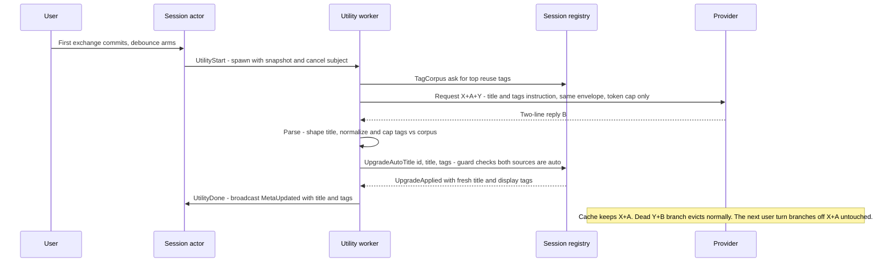

# Nexus: model-generated session tags via the utility branch

> **Landed 2026-11-03** (P2–P5; see §7 for the phase record). Everything
> below shipped as designed, including the offline suite and the e2e
> browser coverage. The one deferred piece is **P6** (the refresh
> policy), which stays gated on `SetTags` becoming a durable write
> (reject-on-failure or retry) per §3.5/§6 — until then a persisted
> `tags_source` can lag an in-memory manual freeze, which a refresh
> policy would wrongly read as permission.

Design for the deferred tags pass of `docs/plans/utility-titles.md` §7:
model-generated tags ride the **same** once-per-session prefix-cache branch
as the title — one instruction Y, one request, one branch — with a
merge-not-clobber policy, a provenance column, and the vocabulary-growth
controls §7 requires. The serving facts and the piggybacking mechanics are
not re-derived here; see `utility-titles.md` §2 and the `.agents/skills/llm-api`
skill.

> Decisions from the 2026-11-01 planning session:
>
> - **Timing: once, with the title attempt — seams ready for later re-arm.**
>   No new session-actor trigger state; tags and title come from the same
>   completion. The schema and apply design must not preclude a future
>   "refresh every N turns" policy — which means the provenance column lands
>   now and the merge stays idempotent.
> - **Reply format: two-line plain text.** Line 1 = title, line 2 =
>   comma-separated tags. No JSON — parsing stays string-shaping like the
>   title parser, which small local models fumble less than structured
>   output.
> - **Merge guard: provenance-gated, per side** — mirrors the title guard
>   with a sibling `tags_source` column. A manual rename stops
>   auto-titling; a manual tag edit stops auto-tagging; either way the
>   store guard is atomic, so an in-flight utility apply cannot land
>   after a manual save. One ask applies both writes, guarded by both
>   provenance columns. *(Refined in the 2026-11-01 review round: the
>   original sketch reused `title_source` alone, which left a manual tag
>   save open to a racing model merge.)*
> - **Chips indistinguishable** in the UI — one style; provenance stays
>   schema-only.
> - **§7 controls as recommended there: (1) + (2) now, (3) later.**
>   Corpus-constrained generation and normalization/caps this pass; the
>   prune sweep only if the corpus still drifts.

## 1. Goal and non-goals

**Goal.** The utility branch's instruction asks for a title AND a handful of
tags in one reply. Tags are normalized, capped, and unioned into the
session's display set while both provenance guards are `'auto'`; manual tag
edits write the user's exact set and, like a manual rename, end the auto
path — atomically, at the store guard, so even an in-flight utility apply
cannot land model tags after a manual save. Growth is bounded per session
(≤ 2 new tags per attempt, ≤ 5 tags per session) and steered toward reuse
by corpus-constrained generation. The GLOBAL vocabulary is shaped, not
hard-bounded, by these rules — every session may still introduce new
tags; the deferred prune sweep (§7 control 3) is the cleanup if real
drift appears.

**Non-goals (this plan).**

- Refreshing tags as the conversation evolves (every N turns, on topic
  drift). The once-per-session trigger is unchanged; the schema
  (`tags_manual` + `tags_source`) and the idempotent merge are shaped so
  a later refresh policy needs no migration — but refresh additionally
  requires upgrading `SetTags` to a durable write first (§3.5, §6), and
  nothing here re-arms the branch.
- The prune sweep (§7 control 3).
- Re-tagging sessions that already spent their title attempt before this
  pass — consistent with utility-titles §8's no-retro-trigger decision.
- Any UI provenance affordance (distinct chip styles, per-tag source
  display).

## 2. Current state (seams this builds on)

| Piece | File | Today |
|---|---|---|
| Utility module | `src/nexus/utility.gleam` | `instruction(allow_pass)`, `prepare`, `options` (cap 512), `parse → Verdict(Title/Pass)`, `run` via `openai.stream_with_cancel` |
| Session actor | `src/nexus/session.gleam` | `UtilityRunner`/`UtilityApply` seams in `SessionSpec`; `UtilityState`, `utility_attempted` (flips only on completion), `utility_passes` (max 1), `utility_pending`, cancel-on-send, PASS postpone — `UtilityApplied(title, tags)` and `UtilityMeta(title, tags)` already carry tags |
| Registry | `src/nexus/session_registry.gleam` | `UpgradeAutoTitle(id, title, reply)` guarded `title_source='auto'` (twin-invariant: in-memory + store); `utility_apply_for(registry, id)` closure runs in the worker; `SetTags` + `normalize_tags`; every session's tags already held in memory (active `Record`s + `dormant` `StoredSummary`s) |
| Store | `src/nexus/store/sql/` | `auto_title_upgrade.sql`, `set_tags.sql` (display set only), `insert_session.sql` (lists `tags`), `get_session.sql` / `list_summaries.sql` |
| Schema | `sql/schema.sql` | `session.tags text[] NOT NULL DEFAULT '{}'` + GIN index `session_tags` |
| UI | `src/nexus/ui.gleam` | tag chips (Lustre text nodes, click-to-filter), inline tags editor (`tags_open`), `MetaUpdated` → sidebar refresh |
| Config | `src/nexus/config.gleam` | `NEXUS_UTILITY_ENABLED` (default true), `NEXUS_UTILITY_DELAY_MS` (default 1500) — reused as-is, no new knobs |
| Tests | `test/`, `e2e/` | `utility_test`, `session_test` (fake runner), `session_persistence_test` + `store_mock`, `ui_test`, untouched `m3_prefix_test`; `e2e/browser.spec.mjs` (~L905–930) pins the utility-branch prefix property |

## 3. Design

### 3.1 Reply protocol (two-line plain text)

```
Fix login redirect loop
login, bug, auth
```

- PASS still matches a WHOLE shaped reply (exactly `pass`, case-insensitive)
  and defers title + tags together — the postpone policy is unchanged.
- Title (line 1) is required: unusable/empty → the attempt fails, exactly
  today's semantics.
- Tags (line 2) are best-effort: absent or malformed → zero tags, and the
  title still applies.
- A leading `Title:` / `Tags:` label on either line is stripped (models
  like echoing the schema).
- Normalization per tag: trim, lowercase, collapse internal whitespace runs
  to `-` (kebab-case), drop empties and duplicates (first wins), and
  truncate at 24 characters (mirroring the title cap's semantics — a cap
  here also bounds the corpus's contribution to Y: 30 entries × 24 chars
  is a hard ceiling). This EXTENDS `normalize_tags` in
  `session_registry.gleam` so manual and auto tags share one rule.
- Vocabulary caps are enforced STRUCTURALLY in the parser, not just
  prompted:
  - at most `K = 2` tags not present in the supplied corpus survive the
    parse (reuse dominates; growth is bounded per attempt);
  - at most 5 tags total per session — the union with the existing display
    set preserves existing order, appends new tags, then truncates.
  - Constants live in `utility.gleam` beside `title_limit`.

### 3.2 Instruction Y (corpus-constrained)

`utility.instruction(allow_pass, corpus: List(String))` — the same base
wording as the title instruction plus: line 2 is a comma-separated tag list
(0–3 tags); when the corpus is non-empty it is listed in the prompt
("Prefer reusing a tag from this list when one fits: a, b, c — you may
introduce at most 2 new tags"). The tool prohibition and the PASS/forced
variants are unchanged, and the forced variant still never mentions the
sentinel.

The corpus makes Y dynamic. That is safe by construction: Y is the tail
message — generation-side, never committed — so the conversation prefix is
untouched no matter what the corpus contains.

### 3.3 Corpus source (in memory, no SQL)

New internal registry message `TagCorpus(reply: Subject(List(String)))`:
counts tags across active `Record`s plus `dormant` `StoredSummary`s (the
registry already holds every session's tags in memory — `list_summaries`
at boot, live records after), keeps tags used by ≥ 2 sessions (frequency
floor: a singleton tag is not yet vocabulary), and returns the top 30 by
count, ties broken alphabetically — deterministic output for a given state.

Every candidate is passed through the SAME `normalize_tags` rule (trim,
lowercase, kebab-case, 24-char truncation, empties dropped) BEFORE
counting, and counting pools case-insensitively — a legacy `Work Notes`
and a canonical `work-notes` are one entry. The corpus therefore cannot
leak arbitrary legacy text into Y: every embedded value is a bounded,
whitespace-free kebab string, so the 30 × 24 bound holds by construction
regardless of what older rows contain.

The real runner is built by the registry's `start`, which already holds the
registry's `process.Name(Msg)`: `session.utility_runner(specs, corpus)`
where `corpus` is a closure over that NAME (no subject capture needed at
build time) performing the `TagCorpus` ask from inside the utility WORKER
via the named subject — exactly the `utility_apply_for` ask pattern. The
`UtilityRunner` TYPE — what `SessionSpec` carries and what test fakes
implement — is UNCHANGED; only the registry-side builder gains the
corpus argument (`start_with_runner`'s test seam gains it too), so the
session actor and existing fakes are untouched by corpus plumbing.

### 3.4 Schema: provenance column

- `session.tags_manual text[] NOT NULL DEFAULT '{}'`, added by a
  `do $$ … $$` block that first checks `pg_attribute` for the column and,
  only when adding it, backfills `update session set tags_manual = tags`
  verbatim — every pre-existing tag is manual, and the union rule below
  never rewrites existing display entries, so verbatim spellings cannot
  skew the display − manual bookkeeping. The migrate runner's splitter
  already understands `$$`-quoted DO blocks (`test/migrate_test.gleam`),
  and the block keeps the schema idempotent (re-runs are no-ops).
- `session.tags_source text NOT NULL DEFAULT 'auto'` (values `'auto'` /
  `'manual'`, mirroring `title_source`), added and backfilled
  `'manual'` for every pre-existing row by the same DO block — which also
  codifies §1's no-retro-tagging decision: sessions that predate this
  feature can never be auto-tagged, exactly as their spent title attempts
  already prevent re-titling. New inserts default `'auto'`; the first
  `SetTags` flips the row to `'manual'` forever.
- `tags` remains the DISPLAY set (the union); `tags_manual` is the user's
  exact set. `display − manual` is the auto contribution — display
  bookkeeping, recomputed on write, per the §7 sketch.
- `tags_source` — not the display − manual difference — is the seam a
  future refresh policy needs: refresh may only ever apply where
  `tags_source = 'auto'`, and the first manual tag edit flips it to
  `'manual'` permanently, so a user-deleted auto tag can never resurrect
  (no tombstone set needed; the guard IS the tombstone). Carrying both
  columns now is how this pass "designs for re-arm later" without
  implementing it.

### 3.5 Registry: one ask, one guard, both writes

- `UpgradeAutoTitle` gains a `tags: List(String)` field. The handler (both
  the active-record and dormant-summary branches, keeping the
  twin-invariant degrade-mode pattern of the title-only version):
  - computes the union in memory: existing display entries pass through
    VERBATIM (never re-canonicalized — a legacy `Work Notes` stays
    `Work Notes`, so display − manual bookkeeping cannot manufacture a
    phantom auto tag), new model tags are normalized and appended when
    not already present (presence check case-insensitive, so `Work
    Notes` and `work-notes` do not duplicate), then truncated to 5;
  - persists title + display tags through ONE store call
    (`auto_meta_upgrade`, below) guarded by BOTH provenance columns
    being `'auto'` — the same guard for both writes, per the planning
    decision, and the store guard is the final word: a manual tag save
    that raced the in-flight worker flips `tags_source` to `'manual'`
    first, and the worker's write-through is refused atomically;
  - refuses everything when the guard fails; on store error keeps the
    in-memory write (the documented degrade mode);
  - replies `UpgradeApplied(title, tags)` with the fresh display set —
    the payload it already carries today.
- `SetTags`: the user's exact set becomes the display set AND the manual
  set, and the row's auto path closes — `set_tags.sql` writes
  `tags = $1, tags_manual = $1, tags_source = 'manual'` in ONE statement,
  so the freeze itself is atomic (all three fields or nothing). A manual
  tag edit freezes the display set as the user wrote it; no later merge
  can alter it, in flight or otherwise.
- **`SetTags` write-through failure.** On a store error, `SetTags` keeps
  the existing manual-metadata degrade mode (`apply_meta` logs the
  failure and keeps the in-memory write — the same convention as every
  manual metadata edit today): the actor's record says `manual`, the
  persisted row may still say `auto`. That stale row is harmless in THIS
  pass, twice over: a racing utility apply is refused by the in-memory
  twin check before the store is ever consulted, and the only writer of
  auto tags — the once-per-session attempt — never fires for a
  rehydrated session (`utility_attempted` hydrates as spent), so a
  restart cannot resurrect auto-tagging from the stale row; the next
  manual save re-attempts the triple-write and heals it. A future
  refresh policy, which WOULD read the row as permission, must first
  upgrade `SetTags` to reject-on-failure or durably retry — recorded as
  a gate in §7.
- `Record` and `StoredSummary` gain `tags_manual` and `tags_source`,
  selected by BOTH `get_session.sql` (rehydration) and
  `list_summaries.sql` (boot load) so no state — active or dormant —
  ever lacks provenance. The UI-facing `session.SessionSummary` is
  unchanged: it simply does not carry the new fields.
- `insert_session.sql`: add `tags_manual` and default `tags_source`
  (`'{}'` / `'auto'` — a new session has no tags and an open auto path).

### 3.6 Store

- `auto_title_upgrade.sql` is REPLACED by `auto_meta_upgrade.sql`:

  ```sql
  update session set title = $1, tags = $3
  where id = $2
    and title_source = 'auto'
    and tags_source = 'auto'
  ```

  Rowcount is the guard outcome — the same shape as today, now guarding
  both provenance columns. The refusal is whole-update: ONE statement
  applies title AND tags, so a manual rename OR a manual tag edit
  refuses the entire apply — there is no per-side landing (the
  2026-11-01 review round's clarification; the SQL comment and the
  registry twin say the same). The registry computed
  the union, so the SQL stores exactly what the memory holds
  (twin-invariant).
- `set_tags.sql` writes all three fields in one statement:
  `set tags = $1, tags_manual = $1, tags_source = 'manual'`.
- Seam: `store.auto_title_upgrade: fn(String, String)` widens to
  `auto_meta_upgrade: fn(String, String, List(String))`; implementation in
  `store/persist.gleam`, mock in `test/store_mock.gleam`; regenerate with
  `gleam run -m squirrel` against the dev DB; the committed `sql.gleam`
  is CI-gated by `squirrel check`.

### 3.7 Session actor

- `UtilityApply` widens from `fn(String) -> Result(UtilityMeta, Nil)` to
  `fn(String, List(String)) -> Result(UtilityMeta, Nil)` (title, tags);
  the worker's `Ok(utility.Title(...))` branch passes both;
  `utility_apply_for` sends the widened ask.
- `utility.Verdict`'s constructor becomes
  `Title(title: String, tags: List(String))`.
- The trigger/cancel/PASS state machines are untouched — the timing
  decision.

### 3.8 UI

None for chips (indistinguishable). The inline tags editor already edits
the display set; a save now also freezes it as manual. Tag rendering is
already text-node-only, so hostile model tags are inert by the existing
contract — a regression test pins it.

### 3.9 Sequence



## 4. Why the cache contract is preserved

Everything from utility-titles §5 still holds, with the deltas noted:

- The request is still built by the one `nexus/transcript` encoder from the
  committed transcript snapshot with the frozen envelope; the only Options
  delta is still `max_completion_tokens` (generation-side only).
- Y is LONGER (the tags ask plus up to ~30 corpus tags) and now varies with
  the corpus — irrelevant to the prefix, because Y is the appended tail and
  is never committed. The branch reply still never enters the session
  transcript.
- `test/m3_prefix_test.gleam` stays green untouched, and the browser
  suite's utility-branch assertions (suffix-only growth, byte-exact
  envelope delta at the documented spot) are unchanged by Y's new wording.

## 5. Verification (offline)

`gleam test` stays offline/network-free (AGENTS.md); the mockable seams
carry everything.

- **`test/utility_test.gleam`** (extend):
  - *Instruction*: both variants ask for the two-line form; corpus listed
    when non-empty, absent when empty; tool ban present; the forced
    variant never mentions PASS.
  - *Parser*: two-line reply, `Title:`/`Tags:` labels stripped, title-only
    reply (no line 2), PASS whole-reply matching, "Password Manager
    Setup" is a title not a pass, hostile `<script>` tag payloads pass
    through inert and normalized, more-than-K new tags truncated to K,
    union with existing tags capped at 5 with order preserved, per-tag
    24-character truncation, empty tags line → zero tags.
  - *Prefix property*: re-run the request-body assertion with the longer
    corpus-carrying Y — messages-suffix-only growth, envelope delta
    exactly `max_completion_tokens`.
- **`test/session_registry_test.gleam`** (extend): merge applies under
  both-auto guards and is refused under manual (title rename AND manual
  tag edit each close their side); union order, verbatim-passthrough, and
  cap; a manual `SetTags` racing an in-flight apply refuses the apply
  (the P1 the review caught); `SetTags` writes display + manual + source,
  and on a failing store write keeps the in-memory freeze (degrade mode)
  while a later apply is still refused; `TagCorpus` determinism
  (frequency floor, count order, alphabetical tie-break),
  normalize-before-counting, and the 30 × 24 embedding bound (a 10 KB
  legacy tag enters the corpus truncated, pooled case-insensitively).
- **`test/session_persistence_test.gleam`** + `test/store_mock.gleam`:
  `auto_meta_upgrade` guard semantics (applies while both sources are
  auto; refuses after a title rename OR a manual tag save; the mock
  records the tags write).
- **`test/session_test.gleam`**: fake `utility_runner` signature
  unchanged; `MetaUpdated` carries model tags when the apply succeeds.
- **`test/ui_test.gleam`**: hostile model tag rendered inert in chips
  (extend the existing MetaUpdated / hostile-title case).
- **`test/migrate_test.gleam`**: the splitter already covers `$$` DO
  blocks; add the new statement shape if not exercised.
- **`test/m3_prefix_test.gleam`** untouched and green.
- **Migration idempotency, live**: run `gleam run -m nexus/store/migrate`
  twice against the dev DB — the second run must be a no-op.

Live/e2e: `e2e/browser.spec.mjs` — the fake model's utility reply is
**landed** as the two-line form (line 1 title, line 2 comma-separated
tags, held in flight a few seconds so the suite can stage the manual
freeze): the suite asserts the model tags land as sidebar chips —
rendered as inert text nodes, `<script>` payload included — that a
manual tags save freezes the set so the racing apply is refused, and
that the utility-branch prefix assertions (suffix-only growth, envelope
delta exactly `max_completion_tokens`) hold byte-exact against the
corpus-carrying Y.

## 6. Risks and open questions

- **`normalize_tags` gets stricter** (lowercase, kebab-case, cap 5) —
  existing manual tags normalize differently on next save; tag filtering
  is already case-insensitive and chips are display-only. Tests pin the
  new rule.
- **Instruction growth**: Y grows by the tags ask + up to ~30 corpus tags,
  bounded by the 24-char per-tag cap (~a kilobyte worst case) — Y+B cost
  only, prefix untouched.
- **Store write-through failure on `SetTags`** (§3.5): the persisted
  `tags_source` can lag the in-memory freeze. Void this pass (twin check
  + spent rehydration attempts), but a hard requirement on the future
  refresh policy — it must not ship before `SetTags` is durable.
- **Model misformats line 2** → tags are best-effort (zero tags, title
  still applies); a failed TITLE line still spends the attempt (existing
  semantics — no silent retry).
- **DO-block migration**: idempotency rests on the `pg_attribute`
  existence check; verified live by running migrate twice.
- **Reasoning models**: the 512-token completion budget must hold
  reasoning plus two short lines — already generous; tags add ~10 tokens.
- **Backends without prefix caching** pay one full prefill — unchanged
  from the title pass, bounded by the once-per-session trigger.
- **Vocabulary growth is shaped, not bounded**: per-attempt (≤ 2 new) and
  per-session (≤ 5) caps bound each session, but N sessions can still
  mint N new singletons. The frequency floor keeps singletons out of the
  corpus (so they don't get promoted to reuse candidates), and the prune
  sweep remains the deferred global cleanup — noted here so the claim is
  honest.
- **Open**: exact instruction wording (finalized in the utility-module
  pass with parser tests as the pin); whether the frequency floor (≥ 2),
  corpus cap (30), and per-tag cap (24) want config knobs — consts first,
  knobs only if real deployments ask.

## 7. Roadmap

- **P1** (landed 2026-11-01): this design doc.
- **P2** (landed 2026-11-02): schema (`tags_manual` + `tags_source` + DO
  block) and store (queries, seam, `squirrel` regen).
- **P3** (landed 2026-11-02): registry (`UpgradeAutoTitle` + tags merge
  under the two-column guard, `SetTags` triple-write, `TagCorpus`,
  `normalize_tags` extension), utility module (two-line
  instruction/parse, corpus), session actor (`UtilityApply` arity).
- **P4** (landed 2026-11-03): offline verification suite (§5).
- **P5** (landed 2026-11-03): e2e browser fake two-line reply + manual
  freeze; `utility-titles.md` §7/§9 updated to record the landed shape.
- **P6 (future, gated — not implemented)**: refresh policy per §1 —
  requires no schema migration, but is BLOCKED on `SetTags` becoming a
  durable write (reject-on-failure or retry) so `tags_source = 'manual'`
  can never lag the row a refresh would read (§3.5, §6).
