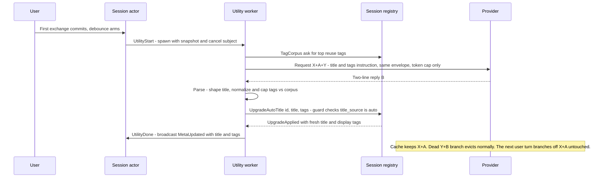

# Nexus: model-generated session tags via the utility branch

Design for the deferred tags pass of `docs/plans/utility-titles.md` §7:
model-generated tags ride the **same** once-per-session prefix-cache branch
as the title — one instruction Y, one request, one branch — with a
merge-not-clobber policy, a provenance column, and the vocabulary-growth
controls §7 requires. The serving facts and the piggybacking mechanics are
not re-derived here; see `utility-titles.md` §2 and the `.agents/skills/llm-api`
skill.

> Decisions from the 2026-11-01 planning session:
>
> - **Timing: once, with the title attempt — seams ready for later re-arm.**
>   No new session-actor trigger state; tags and title come from the same
>   completion. The schema and apply design must not preclude a future
>   "refresh every N turns" policy — which means the provenance column lands
>   now and the merge stays idempotent.
> - **Reply format: two-line plain text.** Line 1 = title, line 2 =
>   comma-separated tags. No JSON — parsing stays string-shaping like the
>   title parser, which small local models fumble less than structured
>   output.
> - **Merge guard: only while `title_source = 'auto'`** — mirrors the title
>   guard. A manual rename stops auto-tagging too: any manual metadata
>   intent freezes auto metadata. One guard, applied to both writes in one
>   ask.
> - **Chips indistinguishable** in the UI — one style; provenance stays
>   schema-only.
> - **§7 controls as recommended there: (1) + (2) now, (3) later.**
>   Corpus-constrained generation and normalization/caps this pass; the
>   prune sweep only if the corpus still drifts.

## 1. Goal and non-goals

**Goal.** The utility branch's instruction asks for a title AND a handful of
tags in one reply. Tags are normalized, capped, and unioned into the
session's display set while `title_source = 'auto'`; manual tag edits write
the user's exact set and, like a manual rename, end the auto path. The
global tag vocabulary stays bounded by reuse-first generation: the
instruction carries the existing tag corpus, the parser structurally caps
how many new tags one attempt may introduce, and per-session tag counts are
capped.

**Non-goals (this plan).**

- Refreshing tags as the conversation evolves (every N turns, on topic
  drift). The once-per-session trigger is unchanged; the schema
  (`tags_manual`) and the idempotent merge are shaped so a later refresh
  policy needs no migration, but nothing here re-arms the branch.
- The prune sweep (§7 control 3).
- Re-tagging sessions that already spent their title attempt before this
  pass — consistent with utility-titles §8's no-retro-trigger decision.
- Any UI provenance affordance (distinct chip styles, per-tag source
  display).

## 2. Current state (seams this builds on)

| Piece | File | Today |
|---|---|---|
| Utility module | `src/nexus/utility.gleam` | `instruction(allow_pass)`, `prepare`, `options` (cap 512), `parse → Verdict(Title/Pass)`, `run` via `openai.stream_with_cancel` |
| Session actor | `src/nexus/session.gleam` | `UtilityRunner`/`UtilityApply` seams in `SessionSpec`; `UtilityState`, `utility_attempted` (flips only on completion), `utility_passes` (max 1), `utility_pending`, cancel-on-send, PASS postpone — `UtilityApplied(title, tags)` and `UtilityMeta(title, tags)` already carry tags |
| Registry | `src/nexus/session_registry.gleam` | `UpgradeAutoTitle(id, title, reply)` guarded `title_source='auto'` (twin-invariant: in-memory + store); `utility_apply_for(registry, id)` closure runs in the worker; `SetTags` + `normalize_tags`; every session's tags already held in memory (active `Record`s + `dormant` `StoredSummary`s) |
| Store | `src/nexus/store/sql/` | `auto_title_upgrade.sql`, `set_tags.sql` (display set only), `insert_session.sql` (lists `tags`), `get_session.sql` / `list_summaries.sql` |
| Schema | `sql/schema.sql` | `session.tags text[] NOT NULL DEFAULT '{}'` + GIN index `session_tags` |
| UI | `src/nexus/ui.gleam` | tag chips (Lustre text nodes, click-to-filter), inline tags editor (`tags_open`), `MetaUpdated` → sidebar refresh |
| Config | `src/nexus/config.gleam` | `NEXUS_UTILITY_ENABLED` (default true), `NEXUS_UTILITY_DELAY_MS` (default 1500) — reused as-is, no new knobs |
| Tests | `test/`, `e2e/` | `utility_test`, `session_test` (fake runner), `session_persistence_test` + `store_mock`, `ui_test`, untouched `m3_prefix_test`; `e2e/browser.spec.mjs` (~L905–930) pins the utility-branch prefix property |

## 3. Design

### 3.1 Reply protocol (two-line plain text)

```
Fix login redirect loop
login, bug, auth
```

- PASS still matches a WHOLE shaped reply (exactly `pass`, case-insensitive)
  and defers title + tags together — the postpone policy is unchanged.
- Title (line 1) is required: unusable/empty → the attempt fails, exactly
  today's semantics.
- Tags (line 2) are best-effort: absent or malformed → zero tags, and the
  title still applies.
- A leading `Title:` / `Tags:` label on either line is stripped (models
  like echoing the schema).
- Normalization per tag: trim, lowercase, collapse internal whitespace runs
  to `-` (kebab-case), drop empties and duplicates (first wins). This
  EXTENDS `normalize_tags` in `session_registry.gleam` so manual and auto
  tags share one rule.
- Vocabulary caps are enforced STRUCTURALLY in the parser, not just
  prompted:
  - at most `K = 2` tags not present in the supplied corpus survive the
    parse (reuse dominates; growth is bounded per attempt);
  - at most 5 tags total per session — the union with the existing display
    set preserves existing order, appends new tags, then truncates.
  - Constants live in `utility.gleam` beside `title_limit`.

### 3.2 Instruction Y (corpus-constrained)

`utility.instruction(allow_pass, corpus: List(String))` — the same base
wording as the title instruction plus: line 2 is a comma-separated tag list
(0–3 tags); when the corpus is non-empty it is listed in the prompt
("Prefer reusing a tag from this list when one fits: a, b, c — you may
introduce at most 2 new tags"). The tool prohibition and the PASS/forced
variants are unchanged, and the forced variant still never mentions the
sentinel.

The corpus makes Y dynamic. That is safe by construction: Y is the tail
message — generation-side, never committed — so the conversation prefix is
untouched no matter what the corpus contains.

### 3.3 Corpus source (in memory, no SQL)

New internal registry message `TagCorpus(reply: Subject(List(String)))`:
counts tags across active `Record`s plus `dormant` `StoredSummary`s (the
registry already holds every session's tags in memory — `list_summaries`
at boot, live records after), keeps tags used by ≥ 2 sessions (frequency
floor: a singleton tag is not yet vocabulary), and returns the top 30 by
count, ties broken alphabetically — deterministic output for a given state.

The real runner closure fetches the corpus inside the utility WORKER via
`actor.call` (exactly the `utility_apply_for` pattern), so the
`UtilityRunner` seam signature
`fn(Endpoint, Transcript, Options, Subject(Nil), Bool)` is UNCHANGED — the
session actor and the test fakes never see corpus plumbing.

### 3.4 Schema: provenance column

- `session.tags_manual text[] NOT NULL DEFAULT '{}'`, added by a
  `do $$ … $$` block that first checks `pg_attribute` for the column and,
  only when adding it, backfills `update session set tags_manual = tags` —
  every pre-existing tag is manual. The migrate runner's splitter already
  understands `$$`-quoted DO blocks (`test/migrate_test.gleam`), and the
  block keeps the schema idempotent (re-runs are no-ops).
- `tags` remains the DISPLAY set (the union); `tags_manual` is the user's
  exact set. `display − manual` is the auto contribution, recomputed on
  write — the §7 sketch, made concrete.
- `tags_manual` is also the column a future refresh policy needs for
  suppression (a user-deleted auto tag must not resurrect); carrying it
  now is how this pass "designs for re-arm later" without implementing it.

### 3.5 Registry: one ask, one guard, both writes

- `UpgradeAutoTitle` gains a `tags: List(String)` field. The handler (both
  the active-record and dormant-summary branches, keeping the
  twin-invariant degrade-mode pattern of the title-only version):
  - computes the union `normalize(existing_display + new_tags)` capped at
    5, in memory;
  - persists title + display tags through ONE store call
    (`auto_meta_upgrade`, below) guarded `title_source = 'auto'` — the
    same guard for both writes, per the planning decision;
  - refuses everything when the guard fails; on store error keeps the
    in-memory write (the documented degrade mode);
  - replies `UpgradeApplied(title, tags)` with the fresh display set —
    the payload it already carries today.
- `SetTags`: the user's exact set becomes BOTH columns (`set_tags.sql`
  writes `tags = $1, tags_manual = $1`). Manual edit freezes the display
  set as the user wrote it; since the attempt is once-per-session, no
  later merge can resurrect anything.
- `Record` and `StoredSummary` gain `tags_manual`; `get_session.sql`
  selects it so rehydration restores provenance. `list_summaries.sql`
  does NOT — summaries don't need it, keeping the UI summary type
  unchanged.
- `insert_session.sql`: add `tags_manual` (`'{}'` — a new session has no
  tags).

### 3.6 Store

- `auto_title_upgrade.sql` is REPLACED by `auto_meta_upgrade.sql`:

  ```sql
  update session set title = $1, tags = $3
  where id = $2 and title_source = 'auto'
  ```

  Rowcount is the guard outcome — the same shape as today. The registry
  computed the union, so the SQL stores exactly what the memory holds
  (twin-invariant).
- Seam: `store.auto_title_upgrade: fn(String, String)` widens to
  `auto_meta_upgrade: fn(String, String, List(String))`; implementation in
  `store/persist.gleam`, mock in `test/store_mock.gleam`; regenerate with
  `gleam run -m squirrel` against the dev DB; the committed `sql.gleam`
  is CI-gated by `squirrel check`.

### 3.7 Session actor

- `UtilityApply` widens from `fn(String) -> Result(UtilityMeta, Nil)` to
  `fn(String, List(String)) -> Result(UtilityMeta, Nil)` (title, tags);
  the worker's `Ok(utility.Title(...))` branch passes both;
  `utility_apply_for` sends the widened ask.
- `utility.Verdict`'s constructor becomes
  `Title(title: String, tags: List(String))`.
- The trigger/cancel/PASS state machines are untouched — the timing
  decision.

### 3.8 UI

None for chips (indistinguishable). The inline tags editor already edits
the display set; a save now also freezes it as manual. Tag rendering is
already text-node-only, so hostile model tags are inert by the existing
contract — a regression test pins it.

### 3.9 Sequence



## 4. Why the cache contract is preserved

Everything from utility-titles §5 still holds, with the deltas noted:

- The request is still built by the one `nexus/transcript` encoder from the
  committed transcript snapshot with the frozen envelope; the only Options
  delta is still `max_completion_tokens` (generation-side only).
- Y is LONGER (the tags ask plus up to ~30 corpus tags) and now varies with
  the corpus — irrelevant to the prefix, because Y is the appended tail and
  is never committed. The branch reply still never enters the session
  transcript.
- `test/m3_prefix_test.gleam` stays green untouched, and the browser
  suite's utility-branch assertions (suffix-only growth, byte-exact
  envelope delta at the documented spot) are unchanged by Y's new wording.

## 5. Verification (offline)

`gleam test` stays offline/network-free (AGENTS.md); the mockable seams
carry everything.

- **`test/utility_test.gleam`** (extend):
  - *Instruction*: both variants ask for the two-line form; corpus listed
    when non-empty, absent when empty; tool ban present; the forced
    variant never mentions PASS.
  - *Parser*: two-line reply, `Title:`/`Tags:` labels stripped, title-only
    reply (no line 2), PASS whole-reply matching, "Password Manager
    Setup" is a title not a pass, hostile `<script>` tag payloads pass
    through inert and normalized, more-than-K new tags truncated to K,
    union with existing tags capped at 5 with order preserved, empty
    tags line → zero tags.
  - *Prefix property*: re-run the request-body assertion with the longer
    corpus-carrying Y — messages-suffix-only growth, envelope delta
    exactly `max_completion_tokens`.
- **`test/session_registry_test.gleam`** (extend): merge applies under the
  auto guard and is refused under manual; union order and cap; `SetTags`
  writes both columns; `TagCorpus` determinism (frequency floor, count
  order, alphabetical tie-break).
- **`test/session_persistence_test.gleam`** + `test/store_mock.gleam`:
  `auto_meta_upgrade` guard semantics (applies on auto, refuses on
  manual; the mock records the tags write).
- **`test/session_test.gleam`**: fake `utility_runner` signature
  unchanged; `MetaUpdated` carries model tags when the apply succeeds.
- **`test/ui_test.gleam`**: hostile model tag rendered inert in chips
  (extend the existing MetaUpdated / hostile-title case).
- **`test/migrate_test.gleam`**: the splitter already covers `$$` DO
  blocks; add the new statement shape if not exercised.
- **`test/m3_prefix_test.gleam`** untouched and green.
- **Migration idempotency, live**: run `gleam run -m nexus/store/migrate`
  twice against the dev DB — the second run must be a no-op.

Live/e2e: `e2e/browser.spec.mjs` — the fake model's utility reply becomes
two-line so chips appear; the utility-branch prefix assertions stay
byte-exact.

## 6. Risks and open questions

- **`normalize_tags` gets stricter** (lowercase, kebab-case, cap 5) —
  existing manual tags normalize differently on next save; tag filtering
  is already case-insensitive and chips are display-only. Tests pin the
  new rule.
- **Instruction growth**: Y grows by the tags ask + up to ~30 corpus tags
  (~a few hundred tokens) — Y+B cost only, prefix untouched.
- **Model misformats line 2** → tags are best-effort (zero tags, title
  still applies); a failed TITLE line still spends the attempt (existing
  semantics — no silent retry).
- **DO-block migration**: idempotency rests on the `pg_attribute`
  existence check; verified live by running migrate twice.
- **Reasoning models**: the 512-token completion budget must hold
  reasoning plus two short lines — already generous; tags add ~10 tokens.
- **Backends without prefix caching** pay one full prefill — unchanged
  from the title pass, bounded by the once-per-session trigger.
- **Open**: exact instruction wording (finalized in the utility-module
  pass with parser tests as the pin); whether the frequency floor (≥ 2)
  and corpus cap (30) want config knobs — consts first, knobs only if
  real deployments ask.

## 7. Roadmap

- **P1 (this pass)**: this design doc.
- **P2**: schema (`tags_manual` + DO block) and store (queries, seam,
  `squirrel` regen).
- **P3**: registry (`UpgradeAutoTitle` + tags merge, `SetTags` twin-write,
  `TagCorpus`, `normalize_tags` extension), utility module (two-line
  instruction/parse, corpus), session actor (`UtilityApply` arity).
- **P4**: offline verification suite (§5).
- **P5**: e2e browser fake two-line reply; `utility-titles.md` §7/§9
  updated to record the landed shape.
